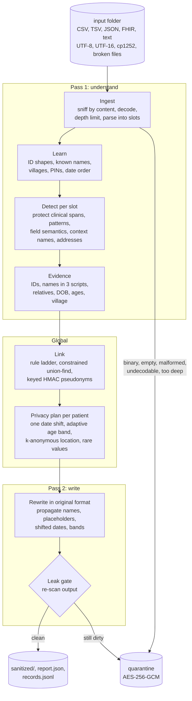

# MedVeil

**An offline, CPU-only, LLM-free privacy firewall for multilingual Indian hospital records.**
Built for Yugaantar DevForge, Track 3 "Secret Wards".

MedVeil reads a messy hospital dump (CSV, TSV, nested JSON, FHIR R4 bundles, discharge
summaries, prescriptions and nursing notes in English, Devanagari Hindi and Hinglish),
removes every piece of personal data, keeps every medical value exactly, gives each real
patient one keyed pseudonym across files, scripts and hospitals, and generalizes the
quasi-identifiers an attacker with a voter list would use.

| Measured on | PII leaked | Canaries | Medical values kept | Linking precision / recall | Wrong merges | Est. attack risk |
|---|---:|---:|---:|---|---:|---:|
| practice data (`dev/`) | 0 of 3,230 | 0 of 4 | 97.7% | 1.00 / 1.00 | 0 | 0.052 |
| chaos sets, seeds 7 and 11 | 0 of 3,234 / 3,230 | 0 of 8 / 4 | 97.8% / 97.7% | 1.00 / 1.00 | 0 | |
| fresh chaos sets, seeds 21 to 40 (20 sets) | 0 in every set | 0 | 97.3% to 97.7% | 1.00 / 0.98 to 1.00 | 0 | |
| adversarial set, seed 3 (tweaked PII, encoded payloads, 27 hostile files) | 0 of 3,245 | 0 of 8 | 97.7% | 1.00 / 0.99 | 0 | |

"Chaos sets" are our own rewrites of the practice data with new patient names, labels,
headers, ID, date and phone formats and new canaries (`tools/chaos_gen.py`). Seeds 7 and 11
were used while developing, so they stopped measuring generalization: fresh seeds 21 to 30
then leaked 1 to 8 pieces each and seed 25 linked only 32% of records, until the header and
label gaps they exposed were fixed. Seeds 31 to 40 were checked only after those fixes. CI
gates all 22 sets. The adversarial
set (`tools/adversarial_gen.py`) tweaks 1,043 PII mentions so they look different but
normalize back to the original, wraps PII in encodings and adds hostile files (see
[Robustness](#robustness-against-tweaked-and-hostile-input)). Attack risk is from our
re-implementation of the organizers' attacks A1 to A7 (`tools/redteam.py`).

Our estimate of the official score on the practice data is **96.98 of 100**
(`tools/scorecard.py`, a re-implementation of `scoring.toml`). On the published baselines it
gives -19.74 for passthrough (official -19.48) and 22.61 for redact-all (official 22.75). The
starter skeleton, for comparison, leaks 84.1% of personal data and links nobody.

**Project Brief (2 pages):** [`docs/brief.pdf`](docs/brief.pdf), built from
[`docs/brief/brief.html`](docs/brief/brief.html).

### Submission checklist (Track 3)

| Requirement | Where / result |
|---|---|
| public repository | https://github.com/mithun50/medveil |
| `raksha.toml` (team name, setup, run) | repo root |
| `requirements.txt`, `README.md`, `config/policy.yaml`, `main.py` | repo root |
| 2-page brief: architecture, USP, privacy-utility trade-off, limitations | `docs/brief.pdf`, sections 1, 3, 4 and 6 |
| output `sanitized/`, `report.json`, `records.jsonl` (plus optional encrypted `quarantine/`) | `validate_output.py --input dev/input --output my_output/`: `CONTRACT OK` |
| pre-submit check | `check_submission.py --repo . --run`: `READY TO SUBMIT` |
| offline | no network code; `socket.connect`, `create_connection` and `getaddrinfo` raise during the run |
| 2 CPUs, 4 GB, 15 min | one process, one thread; 10x the practice data (2,000 files) pinned to 2 CPUs: 52 s, 205 MB peak |
| no LLM or model above 50M parameters | no model at all; runtime imports are the standard library, `cryptography` and `PyYAML` |
| same input and secret give identical output | checked by `check_submission.py` and by CI on every push |
| own work | detection, linking and privacy logic are ours (`medveil/`); the starter was read for the output contract only |

---

## Setup and run

```bash
pip install -r requirements.txt                     # cryptography, PyYAML; the core is standard library
RAKSHA_SECRET=<secret> python main.py --input <input dir> --output <empty output dir>
```

On Windows PowerShell: `$env:RAKSHA_SECRET="<secret>"; python main.py --input ... --output ...`

`raksha.toml` at the repo root is what the evaluator uses. Python 3.10 to 3.13 (CI runs all
four). No network is used or needed during `run`; the process blocks sockets itself.

Output:

```
output/
├── sanitized/      cleaned files, same folders, names (unless a name held PII), formats
├── report.json     every input file by SHA-256, honest counts, timing, peak memory
├── records.jsonl   one line per record: file, loc (row:N, /json/pointer, doc), patient pseudonym or null
├── logs/           (not used: stdout carries one line of counts, nothing else)
└── quarantine/     AES-256-GCM encrypted copies of files we refused to process (not part of the release)
```

Development:

```bash
pip install -r requirements-dev.txt
python -m pytest -q                                             # 332 tests
python tools/ci_gate.py --input ../Secret-Wards-ToolKit/dev/input --truth ../Secret-Wards-ToolKit/dev/truth/truth.json
python tools/chaos_gen.py --kit ../Secret-Wards-ToolKit --out chaos --seed 7
python tools/adversarial_gen.py --kit ../Secret-Wards-ToolKit --out adv --seed 3
python tools/adversarial_gen.py --verify <out> --truth adv/3/truth/truth.json --input adv/3/input
python tools/redteam.py --output <out> --other <out made with another secret>
python tools/scorecard.py --output <out> --repeat <same secret again> --other <another secret> \
    --input ../Secret-Wards-ToolKit/dev/input --truth ../Secret-Wards-ToolKit/dev/truth/truth.json
python tools/sweep.py                                           # privacy versus utility per policy variant
```

---

## Architecture



Two passes are needed because a name is often only recognisable once its owner is known:
"Shahid sahab" in a nursing note, `शाहिद` in a Hindi prescription and `Shahid_Mohammad` in a
file name are found because the registration row ("Mohammad Shahid", UHID, phone) was read
first.

## How each part works

### Ingestion (`medveil/ingest.py`)
- Format is decided by content, not extension; the output path follows the input.
- Encodings: UTF-8 with or without BOM, UTF-16 with or without BOM, cp1252. A file that is
  neither clean UTF-8 nor clean cp1252 (mojibake, corrupt bytes) is quarantined.
- JSON depth is checked with a linear scan before parsing (limit 200), so a 1,500-deep file is
  quarantined without recursion or memory spikes.
- Binary (PDF, JPEG, PNG, ZIP, gzip, 7z, RAR, ELF and PE executables, Mach-O, SQLite,
  WebAssembly...), markup (XML, HTML, a text file that starts with a tag), empty files,
  truncated JSON, JSON with `NaN`, `Infinity` or out-of-range numbers, and JSON behind a `.csv`
  extension are quarantined with an enum reason code. Nothing unprocessed is ever copied into
  `sanitized/`.
- Symlinks are never parsed or copied (reason `symlink`); the target is read only to compute
  the SHA-256 that `report.json` lists. FIFOs, sockets and devices are quarantined as
  `special_file` without being opened.
- Every document becomes records (`row:N`, JSON pointers such as `/visits/3`, or `doc`) made
  of slots: each CSV cell, JSON leaf, JSON key, CSV header, the file name, or a whole note.

### Detection (`medveil/detect/`)
Runs per slot on a normalized view: NFKC, zero-width, bidi and other invisible characters
removed, Cyrillic and Greek homoglyphs folded, Latin diacritics stripped, every Unicode dash
to `-`, Indic, Arabic-Indic and full-width digits to ASCII, `\uXXXX`, HTML entities,
%-encoding and base64 decoded. The scorer normalizes the same way, so a disguised name cannot
slip through. Text longer than 32 KB is detected in chunks of about 4 KB, cut at whitespace.
Each chunk is detected inside a window that adds up to 256 characters before it (cut at
whitespace) and 256 after it (extended to the next whitespace), so a spaced phone number cut
by the boundary is found whole and a label or a doctor's title ending the previous chunk still
applies. Identical windows are detected once; the cache holds up to 4,096 of them. A run with no whitespace at all (a base64 blob) is never cut, so it can still be decoded;
there the cost depends on the patterns staying linear on that run, which the 2 MB probes below
check.

1. **Protect layer** first: doctors (`Dr. ...`, doctor fields, FHIR Practitioner), drugs and
   doses (`Dolo 650`, `5 mg`), frequencies (`1-0-1`, `BD x 5 days`), vitals, labs with units,
   ICD-10 and LOINC codes, eponyms (`Parkinson's disease`), `K/C/O`, `H/O`, `C/O <complaint>`,
   hospital wards (`Ward 4 (Medicine)`), `ASHA workers`, hospital and lab names. Nothing inside
   them is redacted.
2. **Identifiers**: Aadhaar, masked Aadhaar, ABHA number and address, Indian phones in every
   format (`+91 72864 90658`, `060062-72163`, Devanagari digits), PAN, e-mail, PM-JAY and policy
   IDs, labelled IDs in English and Hindi (`UHID:`, `IPD No:`, `CR No.`, `पंजीकरण सं.`,
   `भर्ती क्रमांक`, any `<label> No./ID:`).
3. **ID shape induction**: every value in an ID column becomes a shape (`SNJ/26/064127` to
   `SNJ` + 2 digits + 6 digits). Shapes seen twice become patterns that also match other
   separators and case (`SNJ-26-064127` in a file name, `ipd-2026-00438`). Unseen hospital ID
   formats are learned from the data, not hard-coded.
4. **Field semantics**: CSV headers and JSON keys are typed from a multilingual lexicon
   (`Naam`, `Pita/Pati ka Naam`, `Janam Tithi`, `Gram/Mohalla`, `Contact#`...) and, for unknown
   headers, from value profiling. Every cell still goes through the free-text detectors, so
   shifted columns and ragged rows are safe.
5. **Context names** in three scripts: labels (`Name:`, `नाम:`, `Attendant:`, `called by`),
   relation markers (`S/o`, `W/o`, `C/O` unless a complaint follows, `पुत्र`), the name before a
   relation marker (`Meera, W/o Rajan`), honorifics (`ji`, `sahab`, `behenji`, `Smt.`, `श्री`),
   Hinglish and Hindi postpositions (`Irfan ka BP`, `कविता को`), chat senders, a capitalised name
   right before a phone number (how canaries are caught), and gazetteer given+surname pairs.
6. **Addresses**: house, mohalla, landmark (`near Pani Tanki`, `के पीछे`), village, tehsil, PIN,
   in Latin and Devanagari, plus known villages and PINs from structured fields.
7. **Encoded payloads**: base64 and hex runs in free text are decoded (up to 3 nested levels).
   If the decoded content holds PII, the whole run becomes `[ENCODED-PII-REMOVED]`; runs that
   decode to nothing personal are left alone.

Names are matched in any case after a strong cue (a label, a relation marker, an honorific
with a gazetteer hit), so `name: rohit mehra` and `S/O RAJESH KUMAR` are found. A bare
`Patient:` followed by lowercase words is not treated as a name, because it is usually a
complaint.

The name gazetteers (Faker `en_IN`/`hi_IN`, MIT, plus our own list) only raise confidence.
Context finds names that are in no list, which is what the canaries test.

### Cross-script phonetic key (`medveil/translit.py`)
Our own Devanagari-to-Latin transliteration with schwa deletion (`कमला` to `kamla`, kept after
r/l/y/v conjuncts: `उपेंद्र` to `upendra`), then one Latin folding for both scripts (aspirates,
vowel length, `w`/`v`, `z`/`j`, doubled letters, `-ey`) and a variant table (`Mohammad`,
`Mohd.`, `Md.`, `मोहम्मद` to one key; the `Chaudhary` family to one key). Names compare
order-insensitively with Jaro-Winkler on these keys.

### Linking and pseudonyms (`medveil/link.py`, `medveil/crypto.py`)
- The ladder mirrors the dataset's own definition of "must be linked": L1 a shared strong ID
  (UHID/IPD, Aadhaar, ABHA, PAN, insurance, e-mail), L2 a shared phone, L3 the same full name
  plus DOB, a relative, or village with age within a year, L4 a given name plus the relative's
  name. L3 and L4 only link when the fragment has exactly one candidate.
- Every merge is checked against cannot-link constraints on the pooled evidence of both
  clusters: gender, DOB, Aadhaar/ABHA/PAN, birth-year range, incompatible given names. One bad
  edge cannot chain different people together, so homonyms ("Harish Pandey", 21 and 59) stay
  apart and a shared family phone does not merge husband and wife.
- Records holding several patients (an index keyed by UHID) are never linked.
- Pseudonym = `PSN-` + 8 letters of HMAC-SHA256 over the cluster's canonical key, keyed from
  `RAKSHA_SECRET`. Letters only, so no digits can collide with a real ID's digit core. A new
  secret gives new pseudonyms. The pseudonym is written inside every linked record (ID or name
  slot; a `Patient:` line for notes without one).

### Privacy layer (`medveil/privacy.py`, `medveil/rare.py`)
| Quasi-identifier | Treatment |
|---|---|
| dates | one keyed shift per patient, plus or minus 30 to 365 days, never 0, same format as the input; intervals and stay lengths stay exact |
| date of birth | suppressed (a truthful DOB gives the birth year and undoes age banding) |
| age | 10-year band if 2+ patients share (gender, band, district), else 20 years; 80+ top-coded; one band for all of a patient's records, always containing every true age. Then, against the targeted attack: patients who publish the same diagnosis or procedure are grouped by gender and published district, sorted by age and cut into runs of at least 3, and each band is widened to cover its run, so in a group of 3 or more at least 3 patients fit the demographics of any one of them. A group of 2 is widened together (2 fit); a patient alone with a diagnosis cannot be hidden by age and keeps the band |
| house, mohalla, landmark, village, tehsil | removed; village and tehsil fields become the district |
| district | kept, unless fewer than 3 patients share (gender, band, district): then the state |
| PIN | first 3 digits in PIN fields (`229***`), removed in text |
| rare diagnoses and procedures | shared by 2 or fewer patients: ICD-10 chapter / generic category; eponyms stay exact |

### Security design
Threat model: the machine running MedVeil is breached one day. The attacker gets the disk, not
the memory of a running process.

- **No plaintext intermediates.** Everything stays in memory; no temp files are written.
- **Keys away from data.** `RAKSHA_SECRET` is read once and deleted from `os.environ`. Separate
  keys for pseudonyms, date shifts, file-name codes and the vault are derived with
  HKDF-SHA256 and exist only in memory. Nothing writes a key. (Python cannot reliably wipe
  memory; we do not claim it does.)
- **Encrypted quarantine.** Each refused file is encrypted with its own random AES-256-GCM key,
  wrapped with the vault key (optionally from a separate `RAKSHA_VAULT_KEY`), with the input
  SHA-256 as associated data. Blob names are HMACs, never file names. If `cryptography` is
  missing, nothing is stored (fail closed).
- **PII-free output channels.** stdout gets one line of counts. Exception hooks print only the
  exception class name, because exception messages can carry file content. `report.json`
  identifies files by SHA-256. File names that held PII are renamed.
- **Residual leak gate.** Before a file is written, its serialized output is re-scanned for every
  name token, digit identifier (with any separators), ID and address string detected in that
  file or its patients' records. Hits are redacted; a file still dirty after a second pass is
  quarantined.
- **No network.** `socket.connect`, `create_connection` and `getaddrinfo` raise.
- **Input is read-only.** Files are opened `rb`; the run refuses an output folder inside the input.

## Robustness against tweaked and hostile input

An evaluator can try to slip PII past the detectors with small edits, hide it in an encoding,
or feed files built to crash or stall the pipeline. `tools/adversarial_gen.py` builds such a
set from the practice data (seed 3: 163 files with 1,043 tweaked mentions, 10 wrapped files,
27 hostile files) and its `--verify` mode scans the output with the scorer's normalization
plus payload decoding. It exits 1 on any leak, canary, raw copy of a PII file, hostile file
handled against its declared expectation, or PII from the symlink target found in the release.
CI runs it on every pull request and every push to `main`.

| Tweak | Example | Mentions in seed 3 |
|---|---|---:|
| zero-width characters inside a word | `Ro\u200bhit` | 125 |
| Latin diacritics | `Róhit Méhra` | 92 |
| full-width letters and digits | `Ｒｏｈｉｔ`, `９８７６５` | 162 |
| alternating, lower and upper case | `rOhIt`, `rohit`, `ROHIT` | 216 |
| digits split by spaces, dashes, thin or non-breaking spaces | `98765 43210`, `98765\u201343210` | 271 |
| Devanagari and Arabic-Indic digits | `९८७६५`, `٩٨٧٦٥` | 117 |
| Cyrillic homoglyphs | `Rоhit` with a Cyrillic `о` | 45 |
| PII wrapped in base64 (also nested), `\uXXXX` or %-encoding | `UGF0aWVudCBOYW1l...` | 15 |

Result: 0 of 3,245 PII mentions and 0 of 8 canaries survive.

| Hostile file | Handling |
|---|---|
| ELF or PE executable, gzip or zip bomb, binary polyglot | quarantined (`unsupported_binary`, `undecodable_text`), never decompressed |
| XML "billion laughs", text that starts with a tag | quarantined (`unsupported_markup`), never parsed |
| JSON list nested 10,000 deep | quarantined (`too_deep`) by a linear pre-scan, no recursion |
| JSON with `NaN` or `Infinity` | quarantined (`malformed_json`) |
| symlink pointing outside the input | quarantined (`symlink`): never parsed, copied or stored; a regular target is read only to hash it |
| CSV formula injection, duplicate JSON keys, a 100,000-key object, UTF-16 without BOM, mixed encodings, a bidi file name | sanitized normally |
| notes of up to 2 MB made of one repeated character, label, title word, base64 or hex alphabet | sanitized; each takes at most 5.4 s on its own, startup included |

The whole adversarial set (227 files) runs in 33 s with a 344 MB peak on a laptop, down from
158 s and 616 MB before chunked detection.

Scale: 10 chaos sets together (2,000 files, 8,160 records) run in 43 to 48 s with a 205 MB peak
(was 105 s). Linking used to compare every pair of patients sharing a surname; candidates are
now indexed by the clue that could link them (a shared DOB, relatives or villages), with
byte-identical output, so the run time grows about linearly with the input.

## Privacy and utility trade-off (measured on the practice data)

`tools/sweep.py` runs each policy through our attacker, the utility check and
`tools/scorecard.py` (the sweep uses its own pair of secrets, so figures can differ from the
headline by about 0.01).

| Policy | Est. attack risk | A5 targeted | Utility (of 20) | Est. total (of 100) |
|---|---:|---:|---:|---:|
| district kept everywhere (no state fallback) | 0.171 | 0.541 | 18.96 | 94.65 |
| state fallback at k=3, no condition-aware bands (shipped before) | 0.101 | 0.430 | 18.51 | 95.96 |
| state fallback at k=2 | 0.077 | 0.237 | 18.61 | 96.66 |
| condition-aware bands with runs of 2 | 0.076 | 0.336 | 18.31 | 96.40 |
| **state fallback at k=3, condition-aware bands with runs of 3 (chosen)** | **0.051** | **0.216** | **18.29** | **96.99** |
| same, no rare-value generalization | 0.066 | 0.289 | 18.57 | 96.91 |
| state everywhere | 0.046 | 0.195 | 18.17 | 97.00 |

We keep the district for most patients where it is safe (it matters for public-health
research); "state everywhere" scores the same. The condition-aware bands were the largest
single gain: before them, an attacker who knew that a patient had "Tuberculosis of lung"
found exactly one consistent profile among the 6 that carry it. Tried and rejected:
generalizing a diagnosis whenever its (gender, band, district) class is small (total 95.88,
medical values kept 97.7% to 91.9%), and judging age bands against the published location
(+0.03, within noise). Date of birth shifted instead of suppressed scored lower (94.87 against
95.93 at the time), because a shifted DOB still narrows the profile attack.

## Models

None. No LLM, no generative model, no pretrained transformer. Detection is rules,
gazetteers and our own transliteration code.

## Known limitations

- PDF, images and XML are quarantined, not cleaned (no OCR).
- The attack-risk numbers come from our own re-implementation of the published attacks on the
  practice registry. The official attacker and hidden registry will differ.
- Rare-value generalization is decided within one release; on a very small release common
  diagnoses can look rare and get generalized.
- Condition-aware age bands can be wide (`20-69`) when few patients share a diagnosis, which
  costs age precision; on a larger release the groups are bigger and the bands narrower. The
  length of stay is kept exact for research, so an attacker who knows a stay of a rare length
  can still single out that admission.
- All chaos sets come from our own generator. Fresh seeds found real gaps, so the hidden
  data, made by someone else, will likely find more.
- Names written entirely in lowercase with no context cue (no label, honorific, relation or
  phone nearby) can be missed unless the same person appears elsewhere in structured data.
- A text file that starts with `<` is quarantined as markup even when it is a plain note. In
  our adversarial set this is the one file handled differently from the expected outcome; it
  leaks nothing, but its content is not released.
- `Ward 7` in an address is ambiguous between a municipal ward and a hospital ward; hospital
  wards (`Ward 4 (Medicine)`) are kept, a bare `Ward N` next to address parts is removed.
- `.jsonl` files are treated as plain text.

## Repository layout

```
main.py                 entry point (raksha.toml run command)
config/policy.yaml      privacy policy (every value measured with tools/sweep.py)
medveil/                the pipeline (standard library + cryptography + PyYAML)
tools/                  dev only: redteam, chaos_gen, adversarial_gen, scorecard, sweep, ci_gate,
                        gen_detail, fhir_validate, devcheck, build_lexicons
tests/                  unit and end-to-end tests (synthetic sentences written by us)
docs/                   implementation plan and the 2-page brief
```

## Credits

Team MedVeil: Mithun Gowda B, Pavan, Sandeep, Sujay. Licence: MIT. All data used is
synthetic, from the organizers' kit or generated by our own tools.
