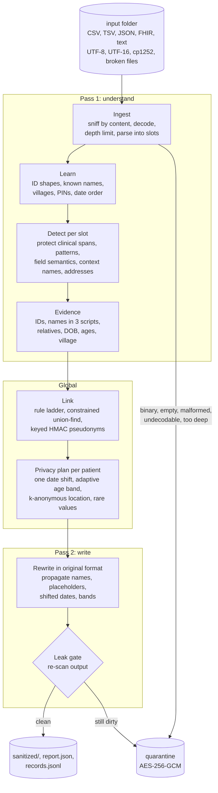

# MedVeil

**An offline, CPU-only, LLM-free privacy firewall for multilingual Indian hospital records.**
Built for Yugaantar DevForge, Track 3 "Secret Wards".

MedVeil reads a messy hospital dump (CSV, TSV, nested JSON, FHIR R4 bundles, discharge
summaries, prescriptions and nursing notes in English, Devanagari Hindi and Hinglish),
removes every piece of personal data, keeps every medical value exactly, gives each real
patient one keyed pseudonym across files, scripts and hospitals, and generalizes the
quasi-identifiers an attacker with a voter list would use.

| Measured on | PII leaked | Canaries | Medical values kept | Linking precision / recall | Wrong merges | Est. attack risk |
|---|---:|---:|---:|---|---:|---:|
| practice data (`dev/`) | 0 of 3,230 | 0 of 4 | 97.8% | 1.00 / 1.00 | 0 | 0.109 |
| held-out chaos set, seed 7 | 0 of 3,234 | 0 of 8 | 97.9% | 1.00 / 1.00 | 0 | |
| held-out chaos set, seed 11 | 0 of 3,230 | 0 of 4 | 98.1% | 1.00 / 1.00 | 0 | |

"Chaos sets" are our own rewrites of the practice data with new patient names, labels,
headers, ID, date and phone formats and new canaries (`tools/chaos_gen.py`). Attack risk is
from our re-implementation of the organizers' attacks A1 to A7 (`tools/redteam.py`). The
starter skeleton, for comparison, leaks 84.1% of personal data and links nobody.

---

## Setup and run

```bash
pip install -r requirements.txt                     # cryptography, PyYAML; the core is standard library
RAKSHA_SECRET=<secret> python main.py --input <input dir> --output <empty output dir>
```

On Windows PowerShell: `$env:RAKSHA_SECRET="<secret>"; python main.py --input ... --output ...`

`raksha.toml` at the repo root is what the evaluator uses. Python 3.10 to 3.13 (CI runs all
four). No network is used or needed during `run`; the process blocks sockets itself.

Output:

```
output/
├── sanitized/      cleaned files, same folders, names (unless a name held PII), formats
├── report.json     every input file by SHA-256, honest counts, timing, peak memory
├── records.jsonl   one line per record: file, loc (row:N, /json/pointer, doc), patient pseudonym or null
├── logs/           (not used: stdout carries one line of counts, nothing else)
└── quarantine/     AES-256-GCM encrypted copies of files we refused to process (not part of the release)
```

Development:

```bash
pip install -r requirements-dev.txt
python -m pytest -q                                             # 84 tests
python tools/ci_gate.py --input ../Secret-Wards-ToolKit/dev/input --truth ../Secret-Wards-ToolKit/dev/truth/truth.json
python tools/chaos_gen.py --kit ../Secret-Wards-ToolKit --out chaos --seed 7
python tools/redteam.py --output <out> --other <out made with another secret>
python tools/sweep.py                                           # privacy versus utility per policy variant
```

---

## Architecture



Two passes are needed because a name is often only recognisable once its owner is known:
"Shahid sahab" in a nursing note, `शाहिद` in a Hindi prescription and `Shahid_Mohammad` in a
file name are found because the registration row ("Mohammad Shahid", UHID, phone) was read
first.

## How each part works

### Ingestion (`medveil/ingest.py`)
- Format is decided by content, not extension; the output path follows the input.
- Encodings: UTF-8 with or without BOM, UTF-16 with or without BOM, cp1252. A file that is
  neither clean UTF-8 nor clean cp1252 (mojibake, corrupt bytes) is quarantined.
- JSON depth is checked with a linear scan before parsing (limit 200), so a 1,500-deep file is
  quarantined without recursion or memory spikes.
- Binary (PDF, JPEG, PNG, ZIP...), markup (XML, HTML), empty files, truncated JSON and JSON
  behind a `.csv` extension are quarantined with an enum reason code. Nothing unprocessed is
  ever copied into `sanitized/`.
- Every document becomes records (`row:N`, JSON pointers such as `/visits/3`, or `doc`) made
  of slots: each CSV cell, JSON leaf, JSON key, CSV header, the file name, or a whole note.

### Detection (`medveil/detect/`)
Runs per slot on a normalized view: NFKC, zero-width characters removed, Cyrillic and Greek
homoglyphs folded, Indic digits to ASCII, `\uXXXX`, HTML entities, %-encoding and base64
decoded. The scorer normalizes the same way, so a disguised name cannot slip through.

1. **Protect layer** first: doctors (`Dr. ...`, doctor fields, FHIR Practitioner), drugs and
   doses (`Dolo 650`, `5 mg`), frequencies (`1-0-1`, `BD x 5 days`), vitals, labs with units,
   ICD-10 and LOINC codes, eponyms (`Parkinson's disease`), `K/C/O`, `H/O`, `C/O <complaint>`,
   hospital wards (`Ward 4 (Medicine)`), `ASHA workers`, hospital and lab names. Nothing inside
   them is redacted.
2. **Identifiers**: Aadhaar, masked Aadhaar, ABHA number and address, Indian phones in every
   format (`+91 72864 90658`, `060062-72163`, Devanagari digits), PAN, e-mail, PM-JAY and policy
   IDs, labelled IDs in English and Hindi (`UHID:`, `IPD No:`, `CR No.`, `पंजीकरण सं.`,
   `भर्ती क्रमांक`, any `<label> No./ID:`).
3. **ID shape induction**: every value in an ID column becomes a shape (`SNJ/26/064127` to
   `SNJ` + 2 digits + 6 digits). Shapes seen twice become patterns that also match other
   separators and case (`SNJ-26-064127` in a file name, `ipd-2026-00438`). Unseen hospital ID
   formats are learned from the data, not hard-coded.
4. **Field semantics**: CSV headers and JSON keys are typed from a multilingual lexicon
   (`Naam`, `Pita/Pati ka Naam`, `Janam Tithi`, `Gram/Mohalla`, `Contact#`...) and, for unknown
   headers, from value profiling. Every cell still goes through the free-text detectors, so
   shifted columns and ragged rows are safe.
5. **Context names** in three scripts: labels (`Name:`, `नाम:`, `Attendant:`, `called by`),
   relation markers (`S/o`, `W/o`, `C/O` unless a complaint follows, `पुत्र`), the name before a
   relation marker (`Meera, W/o Rajan`), honorifics (`ji`, `sahab`, `behenji`, `Smt.`, `श्री`),
   Hinglish and Hindi postpositions (`Irfan ka BP`, `कविता को`), chat senders, a capitalised name
   right before a phone number (how canaries are caught), and gazetteer given+surname pairs.
6. **Addresses**: house, mohalla, landmark (`near Pani Tanki`, `के पीछे`), village, tehsil, PIN,
   in Latin and Devanagari, plus known villages and PINs from structured fields.

The name gazetteers (Faker `en_IN`/`hi_IN`, MIT, plus our own list) only raise confidence.
Context finds names that are in no list, which is what the canaries test.

### Cross-script phonetic key (`medveil/translit.py`)
Our own Devanagari-to-Latin transliteration with schwa deletion (`कमला` to `kamla`, kept after
r/l/y/v conjuncts: `उपेंद्र` to `upendra`), then one Latin folding for both scripts (aspirates,
vowel length, `w`/`v`, `z`/`j`, doubled letters, `-ey`) and a variant table (`Mohammad`,
`Mohd.`, `Md.`, `मोहम्मद` to one key; the `Chaudhary` family to one key). Names compare
order-insensitively with Jaro-Winkler on these keys.

### Linking and pseudonyms (`medveil/link.py`, `medveil/crypto.py`)
- The ladder mirrors the dataset's own definition of "must be linked": L1 a shared strong ID
  (UHID/IPD, Aadhaar, ABHA, PAN, insurance, e-mail), L2 a shared phone, L3 the same full name
  plus DOB, a relative, or village with age within a year, L4 a given name plus the relative's
  name. L3 and L4 only link when the fragment has exactly one candidate.
- Every merge is checked against cannot-link constraints on the pooled evidence of both
  clusters: gender, DOB, Aadhaar/ABHA/PAN, birth-year range, incompatible given names. One bad
  edge cannot chain different people together, so homonyms ("Harish Pandey", 21 and 59) stay
  apart and a shared family phone does not merge husband and wife.
- Records holding several patients (an index keyed by UHID) are never linked.
- Pseudonym = `PSN-` + 8 letters of HMAC-SHA256 over the cluster's canonical key, keyed from
  `RAKSHA_SECRET`. Letters only, so no digits can collide with a real ID's digit core. A new
  secret gives new pseudonyms. The pseudonym is written inside every linked record (ID or name
  slot; a `Patient:` line for notes without one).

### Privacy layer (`medveil/privacy.py`, `medveil/rare.py`)
| Quasi-identifier | Treatment |
|---|---|
| dates | one keyed shift per patient, plus or minus 30 to 365 days, never 0, same format as the input; intervals and stay lengths stay exact |
| date of birth | suppressed (a truthful DOB gives the birth year and undoes age banding) |
| age | 10-year band if 2+ patients share (gender, band, district), else 20 years; 80+ top-coded; one band for all of a patient's records, always containing every true age |
| house, mohalla, landmark, village, tehsil | removed; village and tehsil fields become the district |
| district | kept, unless fewer than 3 patients share (gender, band, district): then the state |
| PIN | first 3 digits in PIN fields (`229***`), removed in text |
| rare diagnoses and procedures | shared by 2 or fewer patients: ICD-10 chapter / generic category; eponyms stay exact |

### Security design
Threat model: the machine running MedVeil is breached one day. The attacker gets the disk, not
the memory of a running process.

- **No plaintext intermediates.** Everything stays in memory; no temp files are written.
- **Keys away from data.** `RAKSHA_SECRET` is read once and deleted from `os.environ`. Separate
  keys for pseudonyms, date shifts, file-name codes and the vault are derived with
  HKDF-SHA256 and exist only in memory. Nothing writes a key. (Python cannot reliably wipe
  memory; we do not claim it does.)
- **Encrypted quarantine.** Each refused file is encrypted with its own random AES-256-GCM key,
  wrapped with the vault key (optionally from a separate `RAKSHA_VAULT_KEY`), with the input
  SHA-256 as associated data. Blob names are HMACs, never file names. If `cryptography` is
  missing, nothing is stored (fail closed).
- **PII-free output channels.** stdout gets one line of counts. Exception hooks print only the
  exception class name, because exception messages can carry file content. `report.json`
  identifies files by SHA-256. File names that held PII are renamed.
- **Residual leak gate.** Before a file is written, its serialized output is re-scanned for every
  name token, digit identifier (with any separators), ID and address string detected in that
  file or its patients' records. Hits are redacted; a file still dirty after a second pass is
  quarantined.
- **No network.** `socket.connect`, `create_connection` and `getaddrinfo` raise.
- **Input is read-only.** Files are opened `rb`; the run refuses an output folder inside the input.

## Privacy and utility trade-off (measured on the practice data)

`tools/sweep.py` runs each policy through our attacker and the utility check.

| Policy | Est. attack risk | Est. privacy points (of 25) | Medical values kept |
|---|---:|---:|---:|
| identifiers removed, adaptive bands, district kept (first pipeline) | 0.198 | 20.05 | 100.0% |
| + rare values only | 0.184 | 20.41 | 97.9% |
| + state fallback at k=2 | 0.133 | 21.67 | 97.5% |
| **+ state fallback at k=3 and rare values (chosen)** | **0.109** | **22.28** | **97.8%** |
| state everywhere | 0.109 | 22.29 | 96.0% |

We keep the district for most patients (it matters for public-health research) and give it up
only for patients whose combination is rare. The remaining risk is mostly the targeted attack
(A5): a patient whose condition is shared by few people of the same gender and age band can
still be singled out by someone who knows that condition.

## Models

None. No LLM, no generative model, no pretrained transformer. Detection is rules,
gazetteers and our own transliteration code.

## Known limitations

- PDF, images and XML are quarantined, not cleaned (no OCR).
- The attack-risk numbers come from our own re-implementation of the published attacks on the
  practice registry. The official attacker and hidden registry will differ.
- Rare-value generalization is decided within one release; on a very small release common
  diagnoses can look rare and get generalized.
- Names written entirely in lowercase with no context cue (no label, honorific, relation or
  phone nearby) can be missed unless the same person appears elsewhere in structured data.
- `.jsonl` files are treated as plain text.

## Repository layout

```
main.py                 entry point (raksha.toml run command)
config/policy.yaml      privacy policy (every value measured with tools/sweep.py)
medveil/                the pipeline (standard library + cryptography + PyYAML)
tools/                  dev only: redteam, chaos_gen, sweep, ci_gate, fhir_validate, devcheck, build_lexicons
tests/                  unit and end-to-end tests (synthetic sentences written by us)
docs/                   implementation plan and the 2-page brief
```

## Credits

Team MedVeil: Mithun Gowda B, Pavan, Sandeep, Sujay. Licence: MIT. All data used is
synthetic, from the organizers' kit or generated by our own tools.
