# Secret Wards: Implementation Plan

Track 3, Yugaantar DevForge. Offline, CPU-only, LLM-free privacy firewall for multilingual Indian hospital records.

| | |
|---|---|
| Status | Plan v1, ready for review |
| Kit | `C:\Projects\devforge\Secret-Wards-ToolKit` (cloned from `Reinforce-SST/Secret-Wards-ToolKit`) |
| Our repo | `C:\Projects\devforge\<team-repo>` (new public repo, created during the event) |
| Team name | `<team-name>` (placeholder, also goes in `raksha.toml`) |

---

## 0. TL;DR

We build a two-pass pipeline in Python. Pass 1 reads every file, finds personal data and collects identity evidence. A global step links records into patients and plans the privacy treatment per patient. Pass 2 rewrites every file in its original format, then a leak gate re-scans the output before anything is written.

Key decisions:

1. **Stdlib-first core.** Only `cryptography` and `PyYAML` as runtime dependencies. Current `rapidfuzz` (3.14.6) and `jellyfish` (1.3.0) require Python 3.11+, and the evaluator's Python version is not stated, so we implement Jaro-Winkler and our phonetic keys ourselves.
2. **Context over memory.** Detection is driven by labels, relation markers, honorifics, Hindi postpositions, header semantics and value shapes, not by lists of practice names. ID formats are learned at runtime from the data ("ID shape induction").
3. **One cross-script phonetic key.** Our own Devanagari-to-Latin skeleton with schwa deletion plus Latin variant folding, so `मोहम्मद शाहिद`, `Mohd. Shahid` and `Shahid Mohammad` compare equal.
4. **Precision-first linking.** A rule ladder that mirrors the dataset's own linkability rule, a constrained union-find that refuses merges which create contradictions, and `null` when evidence is weak.
5. **Privacy per patient, not per record.** Every record of a patient gets the same date shift, the same age band and the same location level, so pooling records under one pseudonym gives the attacker nothing extra. Age bands are adaptive (10 to 20 years), DOB is suppressed, rare diagnoses are generalized.
6. **We measure privacy ourselves.** A local re-implementation of attacks A1 to A7 runs on the practice registry and known facts. Policy knobs are chosen from its numbers.
7. **We test on data we did not tune on.** A chaos generator rewrites the practice data with new names, labels, headers, ID and date formats, and updates the answer key so `check_dev.py` still works.
8. **Fail closed.** Anything we cannot parse or cannot clean is quarantined into an AES-256-GCM vault. Logs carry counts only. No temp files.

---

## 1. What the kit tells us (measured, not assumed)

### 1.1 Practice dataset

Numbers from `dev/truth/truth.json` and `dev/dataset_manifest.json`:

| Item | Value |
|---|---|
| Files | 200 (8 marked `either`: fine to quarantine) |
| Records | 815 (771 must be linked, 2 ambiguous, rest not patient records) |
| Patients / registry population | 48 / 240 |
| Hospitals | 4 (Sanjeevani: CSV UTF-8 BOM, day-first; Jeevan Jyoti: TSV UTF-16 with Hindi headers; Arogya: legacy cp1252 CSV, **month-first**; DH Hardoi: nested JSON, ISO dates, Aadhaar stored as a number under a misspelled key) |
| PII mentions | 3,234 incl. 4 canaries |
| By type | PATIENT_NAME 962, MRN 850, PHONE 308, RELATIVE_NAME 232, VILLAGE 150, HOUSE 136, PIN 136, DOB 111, LOCALITY 103, AADHAAR 71, LANDMARK 64, ABHA 46, PAN 22, INSURANCE 22, AADHAAR_MASKED 16, EMAIL 1 |
| By script | latin 2,980, deva 143, hinglish 111 |
| By hiding place | content 3,115, filename 48, metadata 40, JSON key 12, base64 11, CSV header 8 |
| Medical values to preserve | 4,855 probes (lab 745, medication 595, vital 555, doctor 511, frequency 490, lab test 404, dose 298, ICD code 268, diagnosis 237, complaint 176, ...) |
| Diagnoses | 33 distinct; 24 held by 3 patients or fewer; 12 held by exactly one |

Trap examples we saw in the files:

| Trap | Real example from `dev/input` |
|---|---|
| Language | `नाम: मोहम्मद शाहिद` (Rx), `Mohd. Shahid` and `Shahid sahab ka BP 117/82` (nursing), `Shahid_Mohammad` (file name) |
| Meaning | `C/O Ramesh Patel, Ward 1` (relative + locality) next to `Dr. Ramesh Srivastava reviewed the patient.` and `C/O fever for 8 days`; `K/C/O addison's disease`; `Dolo 650 BD x 5 days`; `Ward: 4 (Medicine)`; `ASHA workers` |
| Fragmented | `Asha, W/o Kamal, discharged in stable condition. Visit: 5 September` |
| Re-identification | `97/M` with `Visceral leishmaniasis (kala-azar)`; `Whipple procedure`; `Deep brain stimulation` |
| Hidden leakage | `source_path: D:\HIS\exports\opd\Kavita_Pandey_064371\...`; `7148988804_report_0047.json`; header `JJH-0077112 Zainab`; JSON keys under `by_name`; base64 attachments in FHIR; `\u`-escaped Devanagari; Devanagari digits `८५९९२५३५२५` |
| Canaries | `called by Kaveri Nambiar 94054-71434`, `raised_by.name`, base64 `Consent witnessed by ...`, visitor log `(attendant, bed 12), mob ...` |
| Robustness | PDF, JPEG with EXIF name, CDA XML, empty CSV, truncated JSON, 1,500-deep JSON, invalid UTF-8 bytes, JSON behind a `.csv` extension |

### 1.2 Starter baseline (run on 2026-11-26)

`starter/main.py` with `RAKSHA_SECRET=practice`: `CONTRACT OK`, then `check_dev.py`:

| Measure | Starter |
|---|---|
| PII still visible | 2,718 of 3,230 (84.1%) |
| Devanagari / Hinglish leaked | 100% / 100% |
| Filename, metadata, key, header, base64 leaked | 100% each |
| Canaries found | 4 of 4 |
| Medical values kept | 100% |
| Linking | nothing linked |

Official reference points: starter about 8, delete-everything about 20, organizers' reference firewall about 80 on normal data and about 48 to 50 on the unseen-format ("chaos") dataset.

### 1.3 How much the quasi-identifiers alone reveal

We joined the practice patients to `dev/attacker/registry.csv` and counted how many registry people share each patient's (gender, age band, district). No names, no phones, only generalized fields:

| Generalization | Patients unique in registry | Patients with k of 2 or less | Mean 1/k (approx. A2/A3 risk) |
|---|---:|---:|---:|
| gender + 5-year band + district | 20 / 48 | 33 | 0.64 |
| gender + 10-year band + district | 11 / 48 | 22 | 0.48 |
| gender + 20-year band (80+) + district | 5 / 48 | 11 | 0.30 |
| **adaptive: 10-year if 2+ patients share the class in our release, else 20-year** | **5 / 48** | 15 | 0.35 |
| gender + district only | 0 / 48 | 0 | 0.06 |

The adaptive rule matches full 20-year banding on uniqueness while keeping 19 of 48 patients at 10-year resolution. This is the starting policy; the red-team harness (section 9.3) refines it.

---

## 2. Where the points are and what that means for design

| Scoring fact (`docs/SCORING.md`, `scoring.toml`) | Design consequence |
|---|---|
| Detection recall = 0.5 macro over types + 0.5 macro over scripts | Devanagari (143) and Hinglish (111) mentions carry the same weight as 2,980 Latin ones. They are core work, not polish. |
| Detection score is F2, precision is measured on trap groups (`doctor`, `doctor-vs-relative`, `c/o-complaint`, `k/c/o`, `h/o`, `hospital-ward`, `dose`, `1-0-1`, `eponym`, `asha`) plus clean-document token retention | A protect layer runs before any redaction. Each trap group has unit tests. Clean documents must pass through unchanged. |
| Leak matching normalizes both sides (NFKC, homoglyphs, zero-width, Indic digits, diacritics, casefold) and decodes base64, hex, `\uXXXX`, HTML entities, %-encoding. Digit IDs match across any separator, and UHIDs match on their digit core. | We detect on the same normalized view, decode payloads before detection, and treat a UHID's digit core (`064127`) as the identifier. |
| Penalties: -1 per unique direct identifier or full name (cap 25), -3 per canary (cap 15), anywhere including logs, stderr, temp files, report | A residual leak gate re-scans every output. Logs and stdout carry counts only. Exception messages are never printed. |
| Identity = 0.4 F0.5 + 0.3 B-cubed F1 + 0.1 language + 0.1 fragmented + 0.1 homonym separation. A wrong link is a false merge; an unlinked record costs nothing. | Precision-first ladder, cannot-link constraints, `null` when ambiguous. |
| The pseudonym must appear inside the exported record, otherwise no consistency credit and the attacker ignores it | PSN goes into the ID or name slot of every linked record. |
| A4 joins records through shared pseudonyms and shared reference values (`patient_ref`, `uhid`) | Generalize at cluster level so pooled evidence equals single-record evidence. Unlinked records get per-record opaque tokens, never a shared placeholder. |
| A5 recovers a global date shift; uses visit date, rare condition (x8 when 3 or fewer profiles share it), length of stay | Per-patient keyed shifts. Diagnoses and procedures shared by 3 or fewer profiles are generalized. Stay length stays exact (utility needs it). |
| A6 inverts unkeyed hashes and IDs embedded in pseudonyms; A7 compares a second release with another secret | HMAC keyed by `RAKSHA_SECRET`, letters-only codes, shifts keyed by the secret. |
| Utility: probes at original field (1.0) or elsewhere in the record (0.8); intervals exact; truthful bands; ICD and LOS distributions; token and record retention | One shift per cluster, bands computed from true ages, clinical spans are never touched, no record suppression unless unavoidable. |
| Privacy credit is multiplied by min(1, utility / 0.40) | Utility will sit far above 0.40, so privacy is never capped by the coupling. |
| Generalization is only 10% of utility (2 of 100 points), privacy is 25 points | When the red-team shows a coarser QI buys risk reduction, coarsen it. Section 1.3 shows 5-year to adaptive bands cuts unique patients from 20 to 5. |
| Performance: full marks below 60 s and 512 MB on the `standard` profile; determinism is 20% of the category | Single process, stdlib regex, sorted iteration, no clock values in `sanitized/` or `records.jsonl`. |
| Reference loses about 30 points on the chaos dataset | Generic context rules, header semantics, ID shape induction and our own chaos test sets are where we beat it. |

---

## 3. Hard constraints

| Constraint | How we meet it |
|---|---|
| No LLMs, no generative models, no transformer over 50M params | Rules, gazetteers, our own phonetic code. Optional small logistic-regression name scorer trained on our own synthetic data, declared in README. |
| Offline `run`, network is grounds for disqualification | No network code. A socket guard raises on any connect attempt. No library that downloads resources at import. |
| 2 CPUs, 4 GB, 15 min | Target under 60 s and 512 MB on a 10x practice-size set. |
| Deterministic for the same secret, different for another secret | Sorted walks, sorted sets, HMAC everywhere, no `random`, no time in outputs. |
| Never write `RAKSHA_SECRET` | Read once into a local, removed from `os.environ`, never formatted into strings. |
| Never modify input | Input opened `rb` only. Refuse to run if output is inside input. |
| Never copy an unprocessed file | Every exported byte goes through a rewriter. Quarantined files are only stored encrypted outside `sanitized/`. |
| Never exit 0 with missing files | Every input file gets a report entry. Fatal errors exit non-zero. |
| Original work, repo created during the event | Starter is used for the contract skeleton only. Detection, linking and privacy code are new. |

---

## 4. Architecture

### 4.1 System context

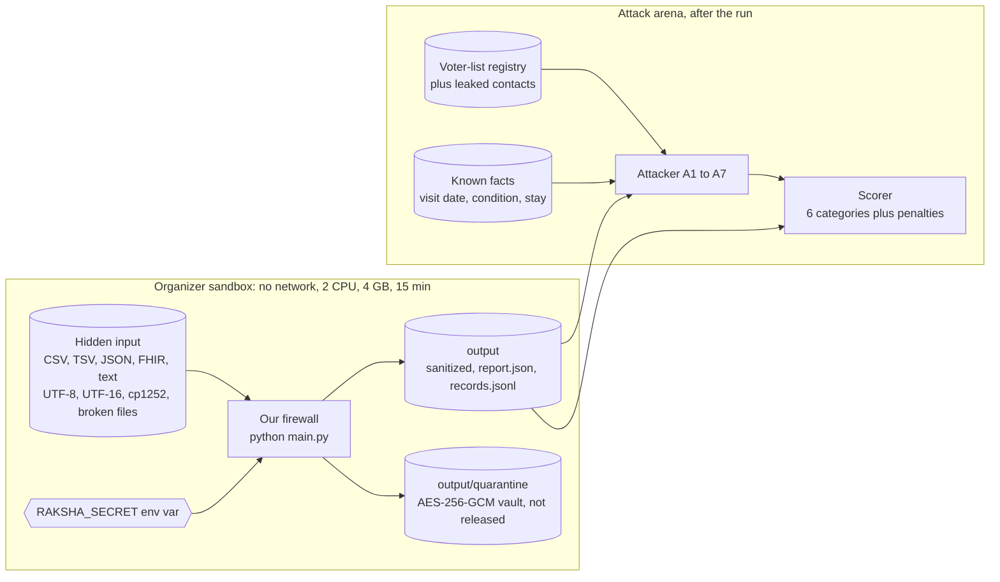

### 4.2 Pipeline (two passes and a global planning step)

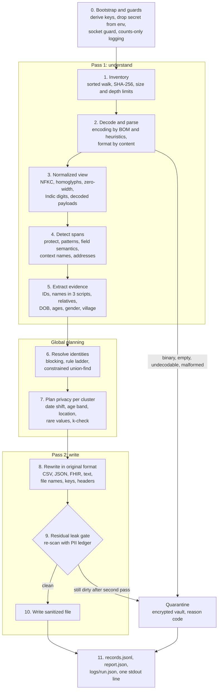

Why two passes: a name found in a registration row ("Mohammad Shahid", phone, UHID) is what lets us remove "Shahid sahab" from a nursing note and "शाहिद" from a Hindi prescription. We can only rewrite after we know who is who.

### 4.3 Run lifecycle

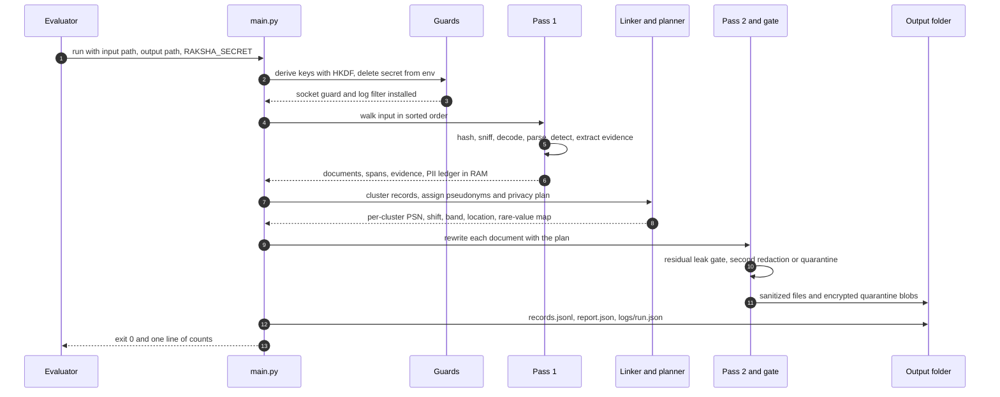

### 4.4 Core data model

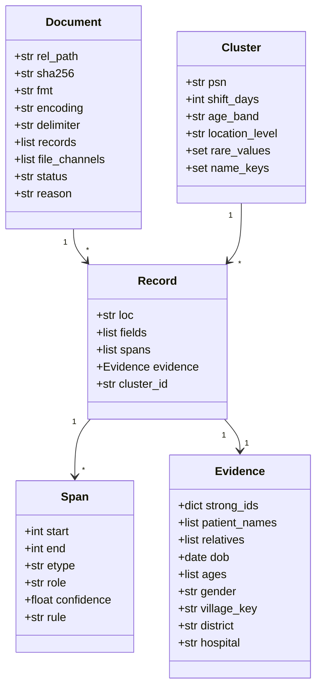

`file_channels` holds the file-level places the scorer checks separately: `@filename`, `@header`, `@file` (metadata and JSON keys).

---

## 5. Component design

### 5.1 Bootstrap and guards (`guard.py`, `crypto.py`)

1. Parse `--input` and `--output`. Refuse if output is inside input, or if output is not empty (dev flag `--force-empty-check-off` for local loops only).
2. Read `RAKSHA_SECRET`. If missing or empty, exit 2 with a fixed message that contains no value.
3. Key schedule, all HKDF-SHA256 from the secret with distinct `info` labels: `K_psn`, `K_shift`, `K_dob`, `K_name` (file names and opaque tokens), `K_vault`. Delete the variable from `os.environ` so child processes and crash dumps do not see it.
4. Install the socket guard (`socket.socket.connect` and `socket.create_connection` raise), `sys.excepthook` and `threading.excepthook` that print only the exception class name, and a logging filter that allows only allowlisted event codes with integer fields.
5. `os.umask(0o077)`. Never call `tempfile`. Verify in tests that `TMPDIR` and `HOME` stay empty.

### 5.2 Ingestion (`ingest/`)

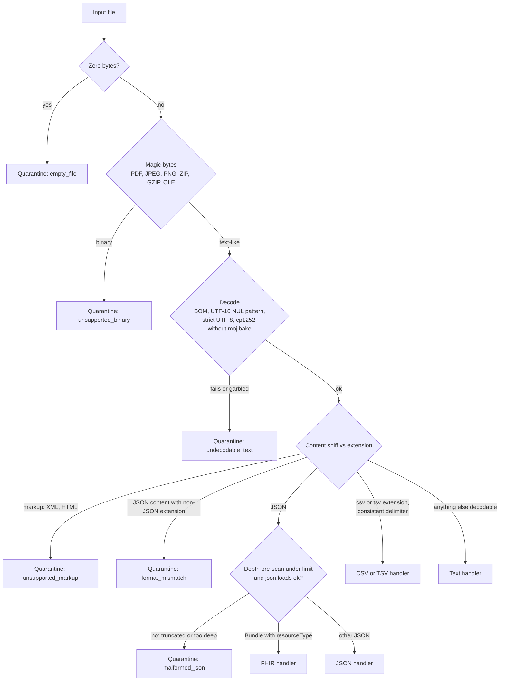

Rules:

- **Encoding order:** UTF-8 BOM, UTF-16 BOM, UTF-16 without BOM (NUL bytes at alternating positions), strict UTF-8, cp1252 strict. A cp1252 result that looks like double-encoded UTF-8 (`Ã`, `â€`) or a UTF-8 decode that fails on a handful of bytes inside otherwise valid UTF-8 is "garbled" and quarantined (policy `on_garbled_text: quarantine`).
- **Depth pre-scan:** a linear bracket counter that ignores string contents, before `json.loads`. Limit 200 (policy). This avoids recursion errors and memory spikes on the 1,500-deep file.
- **CSV:** `csv.reader` with `newline=""` so quoted multi-line notes survive. Delimiter from extension, confirmed by a consistency check. Ragged rows keep their own length.
- **Format follows content, path follows input.** Unknown text extensions (`.log`, `.md`, `.note`, no extension) go to the text handler. `.jsonl` and `.ndjson` are parsed per line (locator convention to confirm with organizers, see section 15).
- **Records:** CSV row `row:N`; JSON elements of arrays of objects that carry person evidence (`/visits/3`, `/patients/0`, `/results/12`, `/tickets/0`); single-object JSON, FHIR Bundles and text notes are `doc`.

Quarantine reason codes (enum, never free text): `empty_file`, `unsupported_binary`, `unsupported_markup`, `undecodable_text`, `malformed_json`, `too_deep`, `format_mismatch`, `too_large`, `handler_error`, `residual_pii`.

### 5.3 Normalized view (`normalize.py`)

The scorer normalizes before matching, so a disguised name still counts as a leak. We normalize first and write the normalized text:

- NFKC, remove zero-width characters (U+200B to U+200D, U+FEFF, U+2060), fold Cyrillic and Greek homoglyphs to Latin, convert Devanagari digits to ASCII.
- Decode hidden payloads for detection: base64 runs (24+ chars, decodes to mostly printable UTF-8), hex runs, `\uXXXX` sequences in text files, HTML entities, %-encoding. If a payload contains PII, it is re-encoded after sanitizing (FHIR attachments must stay valid base64) or replaced with a typed placeholder.
- Line structure is preserved, because the scorer compares text line counts.

### 5.4 Detection engine (`detect/`)

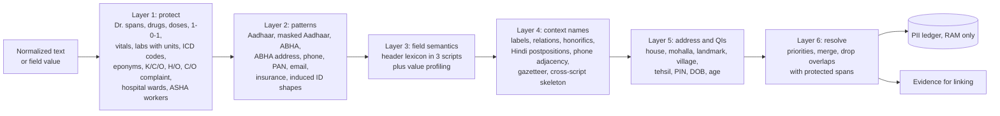

#### Layer 1: protect (meaning traps)

Protected spans are computed first. Later layers may not redact inside them, except strong numeric identifiers.

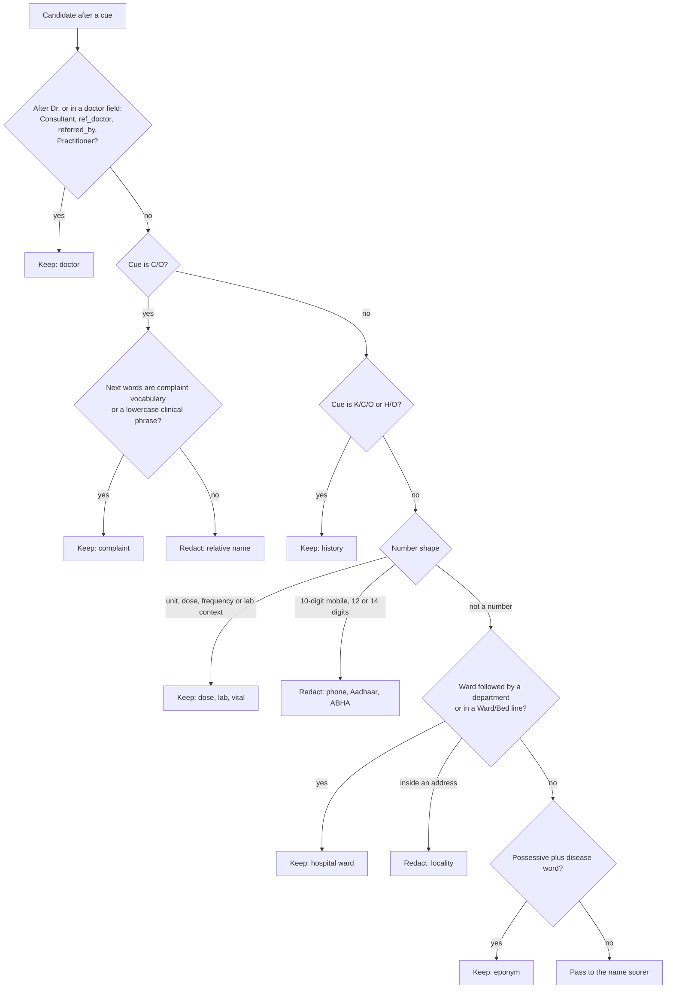

Protected vocabulary (all generic, none taken from practice patients): drug names and dose patterns (`\d+(\.\d+)? ?(mg|mcg|g|ml|IU|units)`, `\d-\d-\d`, `BD|TDS|OD|HS|SOS|QID`, `x \d+ (days|wks|weeks|month)`), vitals (`BP \d+/\d+`, `Pulse`, `SpO2`, `Temp`), lab names with values and units, ICD-10 codes, LOINC codes, department names, hospital and lab names (`<Title words> + Hospital|Pathology|Diagnostics|Clinic|Sadan|Nursing Home`), eponyms (`<Cap>'s (disease|palsy|syndrome|sign)` in any case), `ASHA worker(s)`.

#### Layer 2: patterns

| Type | Shape (sketch) | Context and exclusions |
|---|---|---|
| ABHA number | 14 digits, `91-XXXX-XXXX-XXXX` or plain | Checked before Aadhaar and phone |
| Aadhaar | 12 digits in 4-4-4 groups or plain; JSON numbers with 12 digits | Verhoeff checksum only raises confidence; synthetic numbers may fail it |
| Masked Aadhaar | `XXXX XXXX 1234`, `xxxx-xxxx-1234`, `********1234` | The last 4 digits are in the attacker's leaked-contacts overlay |
| Phone | optional `+91`, `0091`, `91`, `0`, then a 10-digit mobile starting 6 to 9, any of space, dash, dot, brackets; landlines `0XXX-XXXXXXX` in contact contexts | Not next to letters or units; not part of a date or ID |
| Email, ABHA address | standard email; `[\w.]+@(abdm|sbx|ndhm)` | |
| PAN | `[A-Z]{5}\d{4}[A-Z]`, any case | 4th letter `P` raises confidence |
| Insurance | `PMJAY-..-\d{10}`, `POL/\d+/\d+`, plus induced shapes from insurance-like columns | |
| UHID, MRN, IPD, CR No. | **induced shapes** (below) plus labels `UHID`, `MRN`, `Reg No`, `IPD No`, `IP No`, `CR No`, `Hospital No`, `पंजीकरण सं.`, `आईपीडी सं.` | Visit IDs, bill numbers, sample IDs are not PII in truth and are kept |
| PIN | 6 digits starting 1 to 9 | Only in address context, PIN columns, or matching a PIN already seen in a structured field. Never a bare 6-digit regex (platelets are 6 digits). |

**ID shape induction** (`detect/shapes.py`): every value in a column or key classified as an identifier is turned into a shape (`SNJ/26/064127` to `AAA/99/999999`). Shapes seen at least twice become regexes that also match case and separator variants (`SNJ-26-064127`, `snj_26_064127`). Free text and file names are scanned with them. This is how unseen hospital ID formats in the chaos round get caught without hardcoding. Every detected ID also registers its digit core in the ledger, because the scorer matches the core.

#### Layer 3: field semantics (structured columns and JSON keys)

Each CSV column and JSON key path gets a semantic type from two signals:

1. **Header lexicon** in English, Hinglish and Devanagari, matched after normalization (lowercase, strip punctuation, token fuzzy match). Examples: name (`name`, `patient name`, `patient's name`, `naam`, `नाम`, `rogi ka naam`, `मरीज़ का नाम`), relative (`relative name`, `guardian`, `pita/pati ka naam`, `father`, `husband`, `nok`, `attendant`), phone (`mobile`, `contact#`, `phone`, `mob no`, `callback`), village (`village`, `gaon`, `gram`, `gram/mohalla`, `ग्राम`), and so on.
2. **Value profiling** over the column: share of values that parse as phones, IDs (high cardinality, digits plus letters), dates, ages (`48`, `65/F`, `47 वर्ष`), genders, PINs, or name-like strings (1 to 4 title-case or Devanagari tokens, gazetteer hits, no medical vocabulary).

Profiling wins when the header is unknown. A column is never trusted as "safe" because of its header: every cell still goes through layers 2, 4 and 5, which handles shifted columns and ragged rows.

#### Layer 4: context names in three scripts

| Cue | Examples | Script |
|---|---|---|
| Labels | `Name:`, `Patient Name:`, `Pt.`, `Patient:`, `Attendant:`, `called by`, `witnessed by`, `raised by`, `informant`, `नाम:`, `मरीज़ का नाम:`, `पिता का नाम:` | all |
| Relation markers | `S/o`, `D/o`, `W/o`, `C/O` (with the complaint check), `Wd/o`, `B/o` (baby of), `F/o`, `M/o`, `son of`, `wife of`, `पुत्र`, `पुत्री`, `पत्नी`, `पति` | all |
| Honorifics after a name | `ji`, `sahab`, `sahib`, `bhai`, `bhaiya`, `behenji`, `didi`, `amma`, `chacha`, `mausi`, `बाबू`, `जी` | Hinglish, Devanagari |
| Honorifics before a name | `Shri`, `Smt`, `Sri`, `Km`, `Mr`, `Mrs`, `Ms`, `Md.`, `Mohd.`, `श्री`, `श्रीमती`, `सुश्री` | all |
| Hindi postpositions | `<Name> ka/ki/ke/ko/ne BP ...`, `<नाम> को 4 दिन से बुखार` | Hinglish, Devanagari |
| Chat headers | `[30/05/26, 9:32 pm] <sender>:` | Hinglish |
| Phone or ID adjacency | a title-case bigram within a few tokens of a phone or ID, e.g. `<Name> 94054-71434`, `<Name> (attendant, bed 12), mob ...` | all; catches canaries |
| JSON key context | values under keys like `name`, `raised_by`, `contact`, `guardian` | structured |
| Propagation | full names and name tokens from structured fields of the same cluster, in any script; full names globally | all |

Scoring: each candidate span gets a confidence from its cues (label, relation, honorific, adjacency), gazetteer membership (Indian given names and surnames in Latin and Devanagari, built offline from permissively licensed lists), and shape (title-case or ALL CAPS, not in the English, medical or Hindi common-word allowlists). Spans above the threshold are redacted. In free text a title-case token that is in a person context and not explained by any allowlist is redacted by default ("default deny"), because F2 rewards recall.

**Cross-script skeleton** (`translit.py`), our own code:

1. Devanagari to Latin: consonant and matra table, nukta forms (`ज़` to `z`, `क़` to `q`, `फ़` to `f`, `ड़` to `r`), anusvara and chandrabindu to `n`, and schwa deletion (drop the inherent `a` word-finally and in the V C _ C V position).
2. Latin folding for both sides: lowercase, strip honorifics and titles, variant table (`mohammad`, `mohammed`, `muhammad`, `mohd`, `md` to one key; `chaudhary`, `choudhary`, `chowdhury` to one key), then phonetic folds (`aa` to `a`, `ee`/`ii` to `i`, `oo` to `u`, `w` to `v`, `ph` to `f`, `sh`/`s`, aspirates `kh gh ch jh th dh bh` to the plain consonant, doubled letters to single, trailing `a` dropped).
3. Compare token multisets order-insensitively (`Shahid Mohammad` equals `Mohammad Shahid`) with exact skeleton equality or our Jaro-Winkler at 0.92 or higher.

This gives `मोहम्मद शाहिद` = `Mohd. Shahid` = `Shahid_Mohammad`, `Reena` = `Rina`, `Hareesh` = `Harish`, `Fatma` = `Fatima`, `Kamla` = `Kamala`.

#### Layer 5: address and quasi-identifiers

| Type | Latin cues | Devanagari cues |
|---|---|---|
| House | `H.No.`, `House`, `Makan No.`, `Plot`, `#12` | `मकान नं.` |
| Locality | `Mohalla <x>`, `Ward <n>` inside an address, `<x> Colony`, `<x> Basti`, `<x> Tola` | `मोहल्ला` |
| Landmark | `near`, `opp.`, `behind`, `next to` + 1 to 4 words | `के पास`, `के पीछे`, `के सामने` |
| Village | `Vill.`, `Gram`, `Gaon`, columns, plus morphology (`-pur`, `-nagar`, `-ganj`, `-mau`, `-dih`, `-abad`, `-garh`, `-khera`, `Kalan`, `Khurd`) | `ग्राम`, `गांव`, `कलां`, `खुर्द` |
| Tehsil | `Tehsil <x>` | `तहसील` |
| District (kept) | `Distt.`, `District`, gazetteer of real districts | `जिला` |
| PIN | `- 229678` after an address, PIN columns | same |
| DOB, age | `DOB:`, `Age/Sex: 52 Yrs/F`, `48 Y / F`, `65/F`, `Age: 48/F` | `आयु: 48 वर्ष` |

Durations (`x 12 yrs`, `7 yrs back`) and reference ranges (`70-140`) are not ages.

#### Layer 6: resolution

Priority when spans overlap: protected span, strong numeric ID, phone, email/PAN/insurance, patient name, relative name, other person, address parts, QIs. Adjacent address parts merge into one address span so the rewrite can keep the district and drop the rest. Every accepted span adds its normalized surface (and digit core for IDs) to the in-memory PII ledger used by propagation and the leak gate.

#### Hidden channels

| Channel | Handling |
|---|---|
| File names | Tokenize on `_ - . space`; run layers 2, 4 and the ledger. If PII is found, keep non-PII tokens and the extension, replace PII tokens with a keyed 8-letter code: `Discharge_Summary_Fatima_Bano_SNJ-26-064508.txt` becomes `Discharge_Summary_<code>.txt`. Declared in `report.json`. Collisions get a deterministic suffix. |
| CSV headers | Header cells with PII (`JJH-0077112 Zainab`) become the patient's PSN, or `[PATIENT-n]` if unlinked. Other headers stay byte-identical. |
| JSON keys | Keys with PII become PSN or `[REDACTED-n]`, keeping keys unique and order unchanged. |
| Metadata | `_export_meta`, `source_path`, `meta.source`, export comments: the same detectors run on path segments split on `\ / _`. |
| Base64 and encoded payloads | Decode, sanitize, re-encode with the same encoding. Binary payloads in FHIR attachments are replaced by base64 of a fixed placeholder text. |
| Narrative (FHIR `text.div`) | Sanitize inner text, keep a valid XHTML `div` with `xmlns`. |

### 5.5 Identity resolution (`link/`)

Evidence per record: strong IDs (UHID namespace + digit core, IPD number, Aadhaar, ABHA, PAN, insurance, email), phones, patient name keys (all scripts), relative name keys with relation type, DOB (both day-first and month-first readings when ambiguous), ages with the record's encounter date (to estimate birth-year intervals), gender, village key, district, hospital.

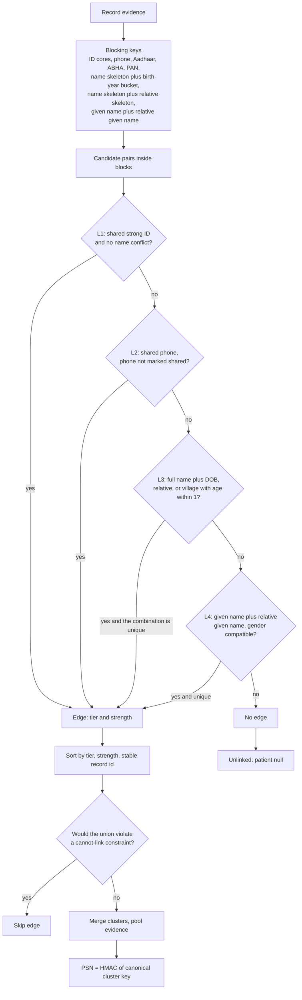

The ladder mirrors how the organizers define "must be linked" in `docs/DATASET.md`: a shared strong identifier that belongs to one patient, or the same name plus a second clue (DOB, relative, or village plus age within 1) whose combination is unique in the whole dataset. Matching that definition keeps us precise on the hidden data too.

**Cannot-link constraints**, checked on pooled cluster evidence before every union:

- two different values of a one-per-person ID (Aadhaar, ABHA, PAN);
- conflicting gender;
- conflicting DOB under every valid reading;
- birth-year intervals from ages and encounter dates that do not overlap (1-year tolerance);
- incompatible given names when both sides have full patient names (skeleton Jaro-Winkler below 0.80);
- a phone attached to two name-incompatible clusters is marked `shared` and stops producing L2 edges (family phones).

This blocks the A-B, B-C chains that over-merge with plain transitive closure, and it separates the homonym pairs (two `Harish Pandey`, ages 21 and 59, different villages and fathers).

**Pseudonyms:** canonical key = smallest sorted strong-ID token in the cluster, else the smallest record id. `PSN-` + 8 letters from HMAC-SHA256(`K_psn`, key), letters-only alphabet so no digit run can collide with a real ID's digit core. Collisions are resolved deterministically with a counter.

**Embedding the PSN inside each record** (required for consistency credit):

| Format | Where the PSN goes |
|---|---|
| CSV | ID column (`UHID`, `uhid`, `patient_ref`) if present, else the patient-name column |
| JSON | `patient_ref` or the record's ID key, else the name value |
| FHIR | `Patient.identifier` (MR) value, `meta.source`, `subject.display` |
| Text | the `Patient Name:` / `नाम:` / `UHID:` slot; if the note has no slot, one `Patient: PSN-...` line at the top |

Unlinked records get per-record opaque tokens (`REC-` + keyed code) in ID slots, never one shared placeholder, so A4 cannot pool unrelated records.

**Name propagation:** each cluster's name keys (patient and relatives, all scripts, full and given-only) are applied in pass 2 to every record of that cluster. Full names (2+ tokens) are applied to every record globally. Protected spans (`Dr. Ramesh Srivastava`) stay.

### 5.6 Privacy layer (`privacy/`)

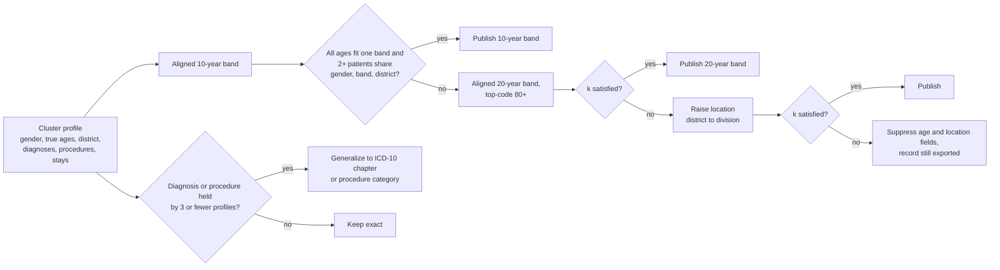

| Quasi-identifier | Default treatment | Scorer credit | Why |
|---|---|---|---|
| Event dates (visit, admission, discharge, lab, registration, chat timestamps, FHIR periods) | Shift by one keyed offset per cluster, uniform in plus or minus 30 to 365 days, never 0. Format, separators, time and timezone preserved. Unlinked records use a per-record key so all dates inside the record keep their gaps. | intervals and LOS exact | Defeats global-shift recovery (A5) and cross-release matching (A7) |
| Partial dates (`5 September`) | Year inferred from context, shifted, rendered in the same partial format | | |
| Date order | Per-file inference (any field above 12 decides; header hints like `(MM/DD/YYYY)`; sibling files of the same source; default day-first) | | Arogya is month-first |
| DOB | **Suppressed** by default (`""` in CSV and JSON strings, key removed in FHIR where `birthDate` is optional, `[DOB]` in text). Alternatives `shift_le_1y` and `year` behind a policy flag. | 0 for DOB fields (about 0.2 points total) | Any truthful DOB gives the birth year and undoes age banding for every record of that patient after A4 pooling |
| Age | Adaptive aligned band from the ladder, same band in every record of the cluster, must contain every true age; written as `40-49`, `40-49 Yrs/F`, `40-49 वर्ष`, `80+` | 10y 0.8, 20y 0.6 | Section 1.3: unique patients 20 to 5 |
| Village, mohalla, house, landmark | Removed; village columns become the district name | village to district 0.7 | Village + band leaves 37 of 48 unique |
| Tehsil | Raised to district | | Tehsil + band leaves 28 of 48 unique |
| District | Kept; raised to division only by the k-check | district kept | Research value; preserve probes |
| PIN | `229***` in PIN fields, removed in free text | 3-digit prefix 0.7 | |
| Gender, hospital | Kept | | Needed for statistics; the attacker knows the hospital anyway |
| Rare diagnoses and procedures | Values held by 3 or fewer profiles (counted on ICD code where present, so Hindi and English forms merge) are generalized to ICD-10 chapter or a procedure category | probe lost for those records only | A5 weights a condition x8 when 3 or fewer profiles share it |
| Length of stay | Kept exact | LOS score | Utility requires it; per-patient shifts cannot hide it anyway |

The **risk engine** (`privacy/kanon.py`) computes, after the plan is applied: patient-level class sizes on (gender, band, district), the rare-value table, and an aggregate count of profiles below `k`. It writes only those aggregate numbers to `logs/run.json`. `records_generalized` in the report counts records where any QI changed. Record suppression is the last resort and is counted in `records_suppressed`.

### 5.7 Rewriters (`rewrite/`)

| Format | Rules |
|---|---|
| CSV and TSV | Same delimiter, header (renamed only if it holds PII), row count and row shape. UTF-8 output, `\n` line endings, quoting via the `csv` module so multi-line notes stay intact. |
| JSON | Same key order, structure and value types. Strings stay strings; numeric Aadhaar or phone values become `0`; generalizable fields (age, dob, pin, village, `age_sex`) may change from number to string band. `ensure_ascii=False`, stable indent. |
| FHIR R4 | Keep Bundle `type`, `identifier.system`/`value`, `timestamp`, Composition first, all `fullUrl` and `urn:uuid` references unchanged so they resolve. Shift `date`, `dateTime`, `instant` values keeping their exact syntax. Replace `name`, `telecom.value`, `address.line`, identifier values; `address.city` to district, `postalCode` to prefix. Keep `gender` codes. Keep Practitioner and Organization names. Re-encode attachments as valid base64. Our structural validator checks the invariants below on every output bundle. |
| Text | Replace spans in place, keep every line. Typed placeholders: patient name to PSN (or `[PATIENT]` if unlinked), `[RELATIVE]`, `[PERSON]`, `[PHONE]`, `[AADHAAR]`, `[ABHA]`, `[MRN]`, `[ADDRESS]`, `[DOB]`. Address lines keep the district: `Address: [ADDRESS], Distt. Rae Bareli`. |
| File names | Section 5.4, hidden channels. |

FHIR invariants we validate locally (from the R4 spec): a document Bundle needs `identifier.system` and `identifier.value` (bdl-9), a `timestamp` (bdl-10), and a Composition as the first entry (bdl-11); `fullUrl` values unique (bdl-7); `date`, `dateTime` and `instant` match the R4 regexes; `base64Binary` matches its regex; every reference resolves inside the Bundle.

### 5.8 Residual leak gate (`gate.py`)

After a file is rewritten and before it is written:

1. Normalize the output the way the scorer does, decode payloads, extract digit runs across separators.
2. Search for every ledger entry that belongs to this file's records, every full name in the global ledger, every strong-ID digit core, and every phone and Aadhaar number seen anywhere. Occurrences inside protected spans are allowed, mirroring the scorer's `allowed` rule.
3. On a hit, redact again with the ledger value as a literal pattern and re-check. If it still hits, quarantine the file with reason `residual_pii`.

The same scan runs once over `report.json`, `records.jsonl`, the output file names and `logs/` before the run ends.

### 5.9 Reporting (`report.py`)

- `report.json`: `schema`, one entry per input file (`input_sha256`, `output` path after renaming or `null`, `status`, `reason` code), `counts` (all nine keys), `entities` per type, `timing.seconds`, `resources.peak_rss_mb` (`resource.getrusage` on Linux, `psutil` fallback in dev).
- Counts are computed from what was actually written: `files_sanitized` = files present in `sanitized/`; `records_processed` = lines in `records.jsonl`; `records_linked` = lines with a non-null patient; `identifiers_detected` = spans replaced across all channels.
- `records.jsonl`: sorted by output file then record order, `sort_keys=True`, `out` locator only when it differs, optional `status`.
- stdout: one line of counts. stderr: nothing on success.

### 5.10 Security design

Threat model: one day the machine that runs the pipeline is breached. The attacker gets the disk (input copy, output, logs, quarantine) but not the memory of a run in progress and not the secret store.

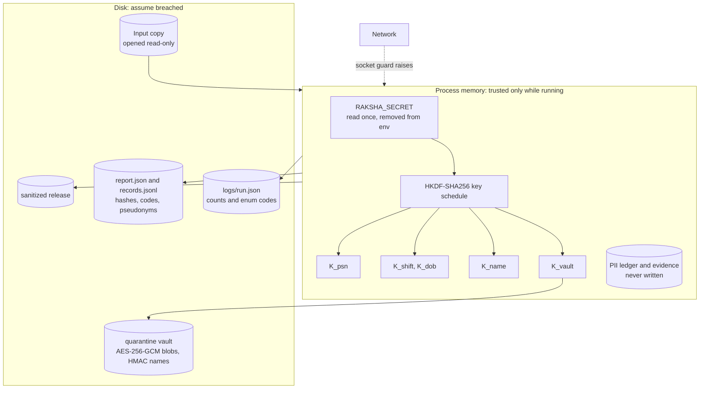

| Control | Design |
|---|---|
| No plaintext intermediates | Everything stays in RAM. If a future large-data mode needs to spill, chunks are AES-256-GCM encrypted with a random per-run key that is never written, so the spill is unreadable after exit (crypto-shredding). |
| Keys away from data | Keys exist only in process memory, derived from the env secret with HKDF and domain-separated labels. `K_vault` can come from a separate `RAKSHA_VAULT_KEY` so a leaked release secret does not open the vault. Python cannot reliably wipe memory; we say so in the README. |
| Quarantine vault | Per-file random 256-bit data key, AES-GCM with a 12-byte random nonce, data key wrapped with `K_vault`, the input SHA-256 as associated data, blob name = HMAC of the SHA-256. The manifest lists only SHA-256 and reason code. Outside `sanitized/`, not part of the release. If `cryptography` is unavailable, the vault is off and nothing is stored (fail closed). |
| Pseudonyms | Keyed HMAC-SHA256, not plain hashing (A6). A new secret gives new pseudonyms and shifts (A7). |
| PII-free logging | Logger accepts only allowlisted event codes with integer fields. Exception hooks print the class name only. No tracebacks, no `faulthandler`, no `warnings` output. |
| Side channels | No temp files, nothing in `HOME`. Output file names are sanitized. `report.json` carries hashes, not names. |
| Input integrity | Read-only open; tests hash the input tree before and after. |
| Network | No network code; socket guard as defense in depth. |
| Supply chain | Two runtime dependencies with bounded versions. Lock with hashes once the evaluator's Python version is confirmed. |
| Fail closed | Unknown format, decode problem, handler exception or residual PII leads to quarantine, never to a raw copy. |

---

## 6. Repository layout

```
<team-repo>/
├── raksha.toml
├── requirements.txt              cryptography, PyYAML (bounded versions)
├── README.md
├── main.py                       thin entry point: from raksha_fw.cli import main
├── config/
│   └── policy.yaml
├── raksha_fw/
│   ├── cli.py                    orchestration, exit codes
│   ├── guard.py                  secret handling, socket guard, hooks, safe logging
│   ├── crypto.py                 HKDF, HMAC pseudonyms and codes, AES-GCM vault
│   ├── policy.py                 load and validate policy.yaml
│   ├── model.py                  Document, Record, Span, Evidence, Cluster
│   ├── normalize.py              NFKC, homoglyphs, zero-width, digits, payload decoding
│   ├── translit.py               Devanagari skeleton, variant folding, Jaro-Winkler
│   ├── ingest/                   inventory.py, decode.py, sniff.py, parsers.py
│   ├── lexicon/                  loader.py + data/*.txt (names, honorifics, relations,
│   │                             headers, medical, English, Hindi common words, districts)
│   ├── detect/                   protect.py, patterns.py, shapes.py, fields.py,
│   │                             names.py, address.py, resolve.py
│   ├── link/                     evidence.py, block.py, rules.py, cluster.py
│   ├── privacy/                  dates.py, generalize.py, kanon.py, rare.py
│   ├── rewrite/                  text.py, csvw.py, jsonw.py, fhir.py, filenames.py
│   ├── gate.py                   residual leak gate
│   └── report.py                 report.json, records.jsonl, logs
├── tools/                        dev only, never imported by the pipeline
│   ├── redteam/attack_sim.py     A1 to A7 on dev registry and known facts
│   ├── chaos_gen.py              held-out variants of dev data plus updated truth
│   ├── scale_gen.py              10x and 20x synthetic sets for speed and memory
│   ├── build_lexicons.py         name and word lists from permissive sources
│   ├── fhir_validate.py          structural R4 checks
│   ├── audit_hardcoding.py       fails if any dev truth surface appears in code or config
│   └── scorecard.py              runs every check and prints one table
├── tests/                        pytest, synthetic fixtures only
├── docs/
│   ├── IMPLEMENTATION_PLAN.md
│   ├── brief.md and brief.pdf
│   └── architecture.md
└── .github/workflows/ci.yml
```

The kit stays a sibling folder. We do not commit `dev/` data, so the organizers' static audit for hard-coded dev identifiers has nothing to flag.

---

## 7. Configuration draft (`config/policy.yaml`)

```yaml
version: 1
pseudonym:
  prefix: "PSN-"
  length: 8
  alphabet: letters_only
dates:
  shift_min_days: 30
  shift_max_days: 365
  unlinked: per_record_key
dob:
  mode: suppress            # suppress | shift_le_1y | year
age:
  ladder: [10, 20]          # aligned band widths, tried in order
  top_code: 80              # ages 80 and above become "80+"
  k_patients: 2             # min patients per (gender, band, district)
location:
  keep_level: district      # house, mohalla, landmark, village, tehsil removed or raised
  pin_prefix_digits: 3
  fallback_level: division
rare_values:
  max_profiles_rare: 3      # attacker treats values shared by 3 or fewer profiles as rare
  diagnosis_fallback: icd_chapter
  procedure_fallback: category
linkage:
  name_similarity: 0.92
  given_name_conflict_below: 0.80
  require_unique_combination: true
  publish_tiers: [L1, L2, L3, L4]
detection:
  default_deny_title_case: true
  name_confidence: 0.5
ingest:
  max_file_mb: 200
  max_json_depth: 200
  on_garbled_text: quarantine
  on_format_mismatch: quarantine
quarantine:
  vault: encrypted          # encrypted | off
logging:
  mode: counts_only
```

---

## 8. Dependencies and environment

| Package | Version found on PyPI (2026-11-26) | Requires Python | Decision |
|---|---|---|---|
| `cryptography` | 50.0.2 | 3.9+ | Runtime: AES-GCM vault, HKDF. Optional: vault turns off if import fails. |
| `PyYAML` | 6.x | 3.8+ | Runtime: `safe_load` of policy. |
| `rapidfuzz` | 3.14.6 | **3.11+** | Not used at runtime; own Jaro-Winkler. |
| `jellyfish` | 1.3.0 | **3.11+** | Not used at runtime; own phonetic keys. |
| `indic-transliteration` | 2.3.83 | any | Dev-time only, to cross-check our skeleton in tests. |
| `phonenumbers` | 9.0.44 | any | Not needed; custom Indian rules are easier to control. |
| `Faker` (en_IN, hi_IN) | current | | Dev-time only: name pools for the chaos generator and gazetteer building. |
| `pytest`, `psutil` | current | | Dev-time only. |

Environment plan:

- The kit's checkers only need Python 3.10+, which suggests 3.10 may be the floor. We keep the core compatible with 3.10 to 3.13 and run CI on all four (`ubuntu-latest`).
- Local Linux check through WSL before every submission (paths, case sensitivity, `python` on PATH, `resource` module).
- `raksha.toml` uses `setup = "pip install -r requirements.txt"` and `run = "python main.py --input {input} --output {output}"`; the evaluator puts `.venv/bin` first on PATH.

---

## 9. Verification strategy

### 9.1 Development loop

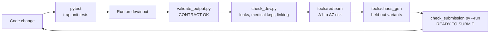

### 9.2 Test matrix

| Area | Tests |
|---|---|
| Meaning traps | One test file per trap group with sentences we write ourselves: doctor vs relative with the same first name, `C/O` complaint vs relative, `K/C/O`, `H/O`, hospital ward vs address ward, doses and `1-0-1`, lab values that look like PINs, eponyms in any case, ASHA |
| Scripts | Devanagari names after `नाम:` and before `को`, Hinglish honorifics and postpositions, ALL CAPS relatives, Devanagari digits, homoglyph and zero-width disguised names |
| Hidden channels | File names, headers, keys, metadata paths, base64, `\u` escapes, HTML entities |
| Linking | Cross-script pairs link; homonym pairs never share a PSN; fragmented `Name, W/o X` links only when unique; shared family phone does not merge two people |
| Privacy properties | Every pair of a cluster's dates keeps its interval; LOS exact; every band contains the true age; same secret gives same bytes; another secret changes every PSN and shift |
| Contract | `validate_output.py` on dev and every chaos set; FHIR validator on every bundle; CSV row counts and shapes; JSON key paths and types |
| Side channels | Run with empty `TMPDIR` and `HOME`, assert both stay empty; grep stdout, stderr, logs, report and records for every ledger value and the secret |
| Robustness | Random bytes, zero-byte files, 5,000-deep JSON, 50 MB single line, mixed encodings, JSON behind `.csv`: never crash, never copy raw |
| Performance | 10x and 20x synthetic sets: wall time and peak RSS against the `standard` profile (60 s, 512 MB) |
| Hardcoding | `audit_hardcoding.py`: no dev patient name, ID or phone in `raksha_fw/`, `config/`, `tests/` |

### 9.3 Red-team harness (`tools/redteam/attack_sim.py`)

A re-implementation of `docs/ATTACKS.md` against `dev/attacker/registry.csv` and `known_facts.jsonl`:

- A1 direct exposure from the leak scan; A2/A3 registry filtering in the documented order with the documented weights (full name x60, given x8, surname x3, relative x8, house x2) and the skip-if-empty rule; A4 profile pooling through pseudonyms and shared reference values with the 0.5 confidence threshold; A5 known-fact matching with global-shift recovery from profiles at 0.9 or higher, rare-condition weight x8, hospital doubling; A6 dictionary of originals with MD5, SHA-1, SHA-256, SHA-512, base64, reversal and prefixes; A7 by running our pipeline twice with different secrets.
- Every component is reported raw and divided by the same attack on the raw input, as the scorer does.
- The policy sweep runs the pipeline with different `age.ladder`, `age.k_patients`, `dob.mode`, `rare_values.max_profiles_rare` and `location.keep_level` values and prints risk next to utility, so the brief can show a measured trade-off curve.

### 9.4 Chaos generator (`tools/chaos_gen.py`)

Rewrites `dev/input` and `dev/truth/truth.json` consistently into new held-out sets:

- new patient names from Faker `en_IN` and `hi_IN` (Latin and Devanagari), new canaries;
- renamed headers and keys (`Patient's Name`, `Contact#`, `Gram/Mohalla`, `Rogi ka Naam`, `contact_no`);
- new label wording in notes (`Pt. Name`, `रोगी का नाम`, `Informant:`);
- new UHID, IPD and insurance formats (`HOSP/UHID/2026/000123`, `CR-26-00431`);
- new date formats (`12-Apr-1977`, `1977.04.12`, `April 12, 1977`) and phone formats (`(+91) 72864-90658`, `0091 7286490658`);
- moved fields and changed nesting in JSON.

`check_dev.py --truth <chaos truth>` then scores us on data we never tuned on. These numbers go into the brief.

### 9.5 Quality gates (CI fails below these)

| Gate | Dev | Chaos sets |
|---|---|---|
| `CONTRACT OK` | required | required |
| Critical identifiers leaked (names full, IDs, phones, Aadhaar, ABHA, PAN, email) | 0 | 0 target, 1% max |
| PII leaked overall / deva / hinglish | 2% / 3% / 3% max | 5% / 6% / 6% max |
| Canaries found | 0 | 0 |
| Medical values kept | 97% min | 95% min |
| Linking precision / F0.5 | 0.99 / 0.95 min | 0.97 / 0.88 min |
| Wrong merges | 0 | 0 |
| FHIR structural errors | 0 | 0 |
| Determinism (2 runs, same secret) | byte-identical | byte-identical |
| Wall time / peak RSS on 10x set | 60 s / 512 MB max | |

---

## 10. Implementation phases

Each phase ends with a measurable exit check. The order is the priority order: if time runs short, later phases shrink, earlier ones do not.

| Phase | Scope | Exit criteria |
|---|---|---|
| **P0 Foundation** | New repo from starter, `raksha.toml`, guards, key schedule, policy loader, CI with 3.10 to 3.13, `scorecard.py` wrapping the kit's checkers | `CONTRACT OK`, `READY TO SUBMIT`, CI green, determinism test passes |
| **P1 Ingestion** | Encoding detection, content sniffing, depth pre-scan, quarantine codes, encrypted vault, record locators | All 8 `either` files quarantined or safely handled; zero raw copies; robustness fuzz passes |
| **P2 Patterns and fields** | Layer 2 patterns, ID shape induction, header lexicon, value profiling, address and QI patterns for structured data, normalized view | Phone, Aadhaar, ABHA, PAN, email, insurance, MRN leaks at 0 on dev; registration and billing files clean |
| **P3 Free-text names** | Protect layer, context cues in 3 scripts, cross-script skeleton, gazetteers, title-case default deny, hidden channels (file names, headers, keys, metadata, base64) | Leaks: overall 5% or less, deva and hinglish 8% or less, canaries 0, medical kept 97% or more, all trap unit tests green |
| **P4 Linking** | Evidence, blocking, ladder, constrained union-find, PSN embedding, name propagation, second detection pass | F0.5 0.95 or more, 0 wrong merges, homonym pairs separated; leaks drop again through propagation |
| **P5 Privacy** | Per-cluster shifts, date format round-trip, adaptive bands, DOB suppression, location and PIN, rare values, risk engine, red-team harness and policy sweep | Interval and band property tests green; red-team A4 under 15% and A5 under 20% on dev |
| **P6 FHIR and gate** | FHIR rewriter and validator, attachment re-encoding, residual leak gate on all outputs and side channels | 0 FHIR errors, gate finds 0 residuals on dev |
| **P7 Chaos hardening** | Chaos generator, fixes for what it exposes, optional small logistic-regression name scorer trained on our own synthetic data | Chaos gates from section 9.5 |
| **P8 Speed and security** | Scale generator, profiling, side-channel tests, WSL run, dependency lock | 10x set under 60 s and 512 MB; TMPDIR and HOME empty |
| **P9 Delivery** | README, architecture diagram, 2-page brief with measured numbers, final `check_submission.py --run`, tag | `READY TO SUBMIT` on a fresh clone, brief PDF committed |

Example schedule for a team of three (the event dates were not given, so Day 1 is a placeholder):

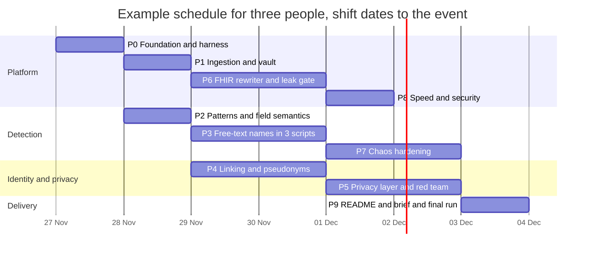

---

## 11. Work split

| Workstream | Owner | Phases | Interfaces it owns |
|---|---|---|---|
| A. Platform | Person 1 | P0, P1, P6, P8 | `Document`/`Record` model, rewriters, gate, report, vault, CI |
| B. Detection | Person 2 | P2, P3, P7 | `Span` producers, lexicons, `normalize.py`, `translit.py`, chaos generator |
| C. Identity and privacy | Person 3 | P4, P5 | `Evidence`, clusters, PSN, privacy plan, red-team harness |
| Shared | all | P9 | README sections for their parts, brief numbers |

Agree on `model.py` and the span placeholder vocabulary on day 1. After that the three streams only meet through those types.

---

## 12. Targets

Targets, not predictions. We check them with `scorecard.py` on dev and on chaos sets.

| Category (points) | Reference firewall | Our target, normal data | Our target, chaos data |
|---|---|---|---|
| Privacy (25) | not published per category | risk 0.15 or less | risk 0.25 or less |
| Detection (20) | | F2 0.95 | F2 0.85 |
| Utility (20) | | 0.90 | 0.85 |
| Identity (15) | | 0.93 | 0.85 |
| Integrity (10) | | 0.95 | 0.92 |
| Performance (10) | | 0.95 | 0.95 |
| Penalties | | 0 | -3 or better |
| **Total** | 80 normal, 48 to 50 chaos | **85+** | **65+** |

---

## 13. Risks and mitigations

| Risk | Impact | Mitigation |
|---|---|---|
| Evaluator runs Python 3.10, a dependency needs 3.11+ | Crash, reliability 0 | Stdlib-first core, CI matrix 3.10 to 3.13, ask organizers |
| Over-redaction (title-case default deny hits medical words) | Contextual precision and token retention drop | Protect layer first, medical and English allowlists, trap tests, token-retention metric in `scorecard.py` |
| False merges through shared phones or common names | Identity score, two histories corrupted | Cannot-link constraints, shared-phone detection, uniqueness rule, homonym tests |
| Canary leaks via logs or exception text | -3 each | Counts-only logger, class-name-only hooks, gate over side channels |
| Unseen ID and label formats in the chaos round | Missed identifiers, -1 each | ID shape induction, header profiling, phone/ID adjacency rule, chaos generator |
| Month-first vs day-first date confusion | Wrong shift, broken intervals, false conflicts | Per-file inference, both readings kept for DOB conflict checks |
| Non-determinism from set or dict order | Determinism points | Sort every iteration that affects output; two-run test in CI |
| Coarse QIs cost more utility than they buy | Lower total | Policy sweep in the red-team harness, decisions backed by numbers |
| Slow regexes on huge lines | Timeout | Linear patterns, line length limit, 20x scale test |
| Rule questions (AI-assisted coding, `dev/` in repo) | Disqualification risk | Ask organizers early (section 15). The no-LLM rule covers the runtime system; confirm the rule for development tools. |

---

## 14. Submission checklist

- [ ] `raksha.toml` at the repo root with the real team name
- [ ] `setup` installs everything; `run` works with the network off (test in WSL with networking disabled)
- [ ] `validate_output.py` prints `CONTRACT OK` on dev and on every chaos set
- [ ] `check_submission.py --repo <repo> --run` prints `READY TO SUBMIT` from a fresh clone
- [ ] Two runs with the same secret are byte-identical; a different secret changes every PSN and shift
- [ ] Nothing personal in stdout, stderr, logs, `TMPDIR`, `HOME`, `report.json`, `records.jsonl`, output file names
- [ ] `RAKSHA_SECRET` never written (checked by `check_submission.py`)
- [ ] README: setup, architecture diagram, how each part works, security design, models declared (none, or our small scorer), known limitations
- [ ] 2-page brief PDF in `docs/brief.pdf` with measured numbers from `check_dev.py`, red-team results and chaos-set results. Pandoc is not installed locally, so we write `docs/brief.html` and print it with Edge headless: `msedge --headless --print-to-pdf=docs\brief.pdf docs\brief.html`.
- [ ] Final commit pushed before the deadline (the last commit at the deadline is what gets scored)

---

## 15. Open questions for the organizers

1. Which Python version does the evaluator use?
2. Is AI-assisted coding allowed during development? (The rules ban LLMs inside the submitted system.)
3. May the practice `dev/` folder be committed to our repo, or should it stay out to avoid the hardcoding audit?
4. If `.jsonl` or `.ndjson` files appear, which locator should `records.jsonl` use per line?
5. Is a single added `Patient: PSN-...` line acceptable for notes that have no natural ID slot?
6. Is an encrypted copy in `output/quarantine/` acceptable, given that folder is not scanned?

---

## 16. References

Content from external sources was rephrased for compliance with licensing restrictions.

- Kit documents: `START_HERE.md`, `docs/PROBLEM_STATEMENT.md`, `docs/SPEC.md`, `docs/SCORING.md`, `docs/ATTACKS.md`, `docs/DATASET.md`, `docs/SANDBOX.md`, `docs/FAIRNESS.md`, `docs/FAQ.md`, `docs/PROJECT_BRIEF.md`, `scoring.toml`
- FHIR R4 Bundle invariants bdl-7 to bdl-12: [hl7.org/fhir/R4/bundle.html](https://hl7.org/fhir/R4/bundle.html)
- FHIR R4 primitive types and regexes (date, dateTime, instant, base64Binary, id): [hl7.org/fhir/R4/datatypes.html](https://hl7.org/fhir/R4/datatypes.html)
- HIPAA Safe Harbor identifiers, 3-digit ZIP rule and the 90-or-older age category: [University of Rochester OHSP](https://www.rochester.edu/ohsp/hipaa-the-18-protected-health-information-phi-identifiers/), [California DHCS list](https://www.dhcs.ca.gov/dataandstats/data/Pages/ListofHIPAAIdentifiers.aspx)
- India DPDP Rules 2025 notified, completing the DPDP Act 2023 framework: [PIB document](https://static.pib.gov.in/WriteReadData/specificdocs/documents/2025/nov/doc20251117695301.pdf)
- Per-individual date shifting that keeps sequence and duration: [Google Sensitive Data Protection, date shifting](https://docs.cloud.google.com/sensitive-data-protection/docs/concepts-date-shifting); Shift and Truncate method: [JAMIA, PubMed 27013522](https://pubmed.ncbi.nlm.nih.gov/27013522/)
- Fellegi-Sunter m and u probabilities: [Splink topic guide](https://moj-analytical-services.github.io/splink/topic_guides/theory/fellegi_sunter.html), [Robin Linacre, m and u values](https://www.robinlinacre.com/m_and_u_values/)
- Transitive closure as the standard clustering step and its over-merging problem: [arXiv 2610.00566](https://arxiv.org/abs/2610.00566v1)
- AES-GCM with a unique 12-byte nonce per key: [cryptography.io AEAD docs](https://cryptography.io/en/latest/hazmat/primitives/aead/)
- Schwa deletion in Hindi orthography: [Wikipedia: Schwa deletion in Indo-Aryan languages](https://en.wikipedia.org/wiki/Schwa_deletion_in_Indo-Aryan_languages)
- Package versions and Python requirements: PyPI JSON for [rapidfuzz](https://pypi.org/project/rapidfuzz/), [jellyfish](https://pypi.org/project/jellyfish/), [cryptography](https://pypi.org/project/cryptography/), [indic-transliteration](https://pypi.org/project/indic-transliteration/), [phonenumbers](https://pypi.org/project/phonenumbers/)
- Faker `hi_IN` person provider (MIT), a source for dev-time name pools: [joke2k/faker](https://github.com/joke2k/faker/tree/master/faker/providers/person/hi_IN)
